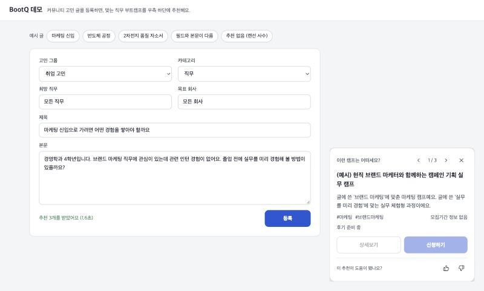
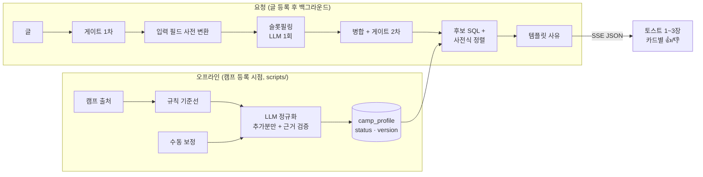

# BootQ

**커뮤니티 고민 글 → 직무 부트캠프 추천.** 취준생이 Q&A 커뮤니티에 취업 고민 글을 올리면, 글을 올린 직후 맞는 직무 부트캠프를 최대 3개 골라 화면 우측 하단 토스트로 보여줍니다.

> 인턴십 팀 프로젝트에서 다룬 문제를, 그때 얻은 결론을 바탕으로 개인 프로젝트로 처음부터 다시 설계했습니다.



## 핵심 아이디어

추천이 틀리는 근본 원인은 비교 로직이 아니라 **데이터 어휘**였습니다. 캠프 쪽 분류 코드가 정리되지 않은 문자열이라, 유저 글에서 뽑은 직무와 맞춰 보려면 예외 규칙이 계속 늘어났습니다. 그래서:

1. **캠프를 오프라인에서 한 번 정규화**합니다. 유저와 캠프가 같은 공통 어휘(대표 직무·산업·산업 계열·스킬)를 쓰게 만들고, 요청 시점에는 계산만 합니다.
2. **LLM은 의미 해석에만, 요청당 1회** 씁니다(글 → 직무·산업 슬롯). 출력은 어휘 Enum으로 강제합니다. 결정할 수 있는 판단(게이트, 후보 조회, 정렬)은 규칙과 SQL이 합니다.
3. **정밀도 > 재현율.** 글을 올린 직후 엉뚱한 추천은 광고로 느껴지므로, 직무·산업 근거가 없으면 아무것도 띄우지 않습니다.

## 동작 방식



| 단계 | 하는 일 |
|---|---|
| 게이트 1차 | 입력 필드만으로 명백한 비대상 글(재직자 회사생활 질문 등)을 거른다 |
| 입력 필드 변환 | 희망 직무 자유 표기(예: "데이터분석가")와 목표 회사를 사전으로 어휘 값으로 바꾼다 |
| 슬롯필링 | 제목·본문 → 직무 후보, 산업, 원하는 도움(탐색/경험/지원 준비), 원문 발췌, 근거(명시/추론). 입력 필드 결과를 힌트로 준다 |
| 병합 | **본문 명시 > 입력 필드 > 본문 추론.** 충돌하면 둘 다 후보로 두고 플래그 |
| 게이트 2차 | 직무·산업 근거가 하나도 없으면 종료 (토스트 없음) |
| 매칭 | 후보 조회는 SQL(직무가 같거나 가까운 캠프), 정렬은 순수 함수. 앞 3개 직무마다 1자리 보장 |
| 사유 | 글에서 발췌한 말과 매칭에 쓰인 값만으로 템플릿 문장 |

### 정렬: 가중합이 아니라 사전식

점수를 더하는 방식은 보상 효과 때문에 직무가 틀린 캠프가 산업·유사도 점수로 올라옵니다. 그래서 키를 순서대로 비교합니다.

1. **직무 등급**: A(같은 일·사실상 같은 일) / B(같은 계열, A가 3개 미만일 때만, 리뷰 플래그) / 제외
2. **산업 등급**: 일치 > 같은 계열 > 산업무관 > 불일치 (유저 산업이 없으면 산업무관 > 산업 전용)
3. **직무 관계**: 정확히 같은 직무 > 사실상 같은 일
4. **원하는 도움 ↔ 캠프 유형**: 직무가 있고, 원하는 도움을 본문에서 직접 말했을 때만

## 주요 설계 결정

결정마다 고려한 대안과 근거는 [`docs/`](docs/)에 남겨 두었습니다. 바뀐 결정과 다시 제안하지 않을 폐기 방안은 [`docs/99_DECISIONS.md`](docs/99_DECISIONS.md)에 있습니다.

| 결정 | 이유 | 문서 |
|---|---|---|
| 직무 ID는 (대분류, 중분류) 복합키 → 대표 직무로 합침 | 같은 이름의 직무가 다른 대분류에 있다 (예: '설계') | [04_DATABASE](docs/rules/04_DATABASE.md) |
| 직무 관계 SAME / CLOSE / FAMILY, CLOSE는 좁게 | 산업이 맞는 CLOSE 캠프가 산업무관 SAME 캠프보다 위로 오므로, 애매한 쌍은 FAMILY | [02_BACKEND 5장](docs/rules/02_BACKEND.md) |
| 산업 → 계열 **집합** (한 산업이 여러 계열) | 유통/물류는 유통·커머스와 물류·무역 둘 다. 계열 포함 여부는 평가로 정함(전자·반도체) | [02_BACKEND](docs/rules/02_BACKEND.md), [EVAL_RESULTS](docs/EVAL_RESULTS.md) |
| LLM 정규화는 기준값을 다시 쓰지 않고 **추가분만**, 근거 구절이 캠프명에 실제로 있는지 코드가 확인 | 재실행마다 결과가 흔들리지 않고, LLM의 기여를 평가에서 분리해 볼 수 있다 | [05_AI](docs/rules/05_AI.md), [12_BATCH_SPEC BAT-003](docs/specs/12_BATCH_SPEC.md) |
| 검수는 LLM 결과가 기준선과 달라진 캠프만, 승인 전에는 기준값으로만 추천 | 검수 부담을 줄이고, 검수 전 결과가 서비스에 새지 않게 | [04_DATABASE](docs/rules/04_DATABASE.md) |
| 레이어드 + 순수 함수 `core/` (DB·LLM·파일 import 금지, 테스트로 검사) | 평가 스크립트가 DB·LLM 없이 같은 매칭 코드를 직접 호출한다 | [02_BACKEND 1장](docs/rules/02_BACKEND.md) |
| 캠프 출처는 주기적으로 복제, 요청 시점에는 조회하지 않음 | 사내 캠프 DB 연동 시 출처 읽기 함수 하나만 추가하면 된다 | [02_BACKEND](docs/rules/02_BACKEND.md) |
| SSE는 DB를 0.5초마다 읽어 결과 하나를 보내고 닫음, 응답은 JSON | 로컬 1명 데모에 가장 단순. JSON이라 실서비스에서 커뮤니티 사이트가 그대로 토스트를 그릴 수 있다 | [10_API_SPEC](docs/specs/10_API_SPEC.md), [03_FRONTEND](docs/rules/03_FRONTEND.md) |
| 카드별 👎 사유를 코드로 받음 | 매칭 근거(직무 관계·산업 등급)와 바로 교차 분석하려고 | [10_API_SPEC API-003](docs/specs/10_API_SPEC.md) |

## 평가 결과

정답 셋은 실제 커뮤니티 글을 바탕으로 **재작성한 질문 23개**입니다(추천이 필요한 질문 20, 추천하지 않는 게 맞는 질문 3). 허용 캠프는 시스템 결과를 보기 전에 판정해 커밋으로 고정했습니다. 설계와 판정 기준은 [`docs/EVAL.md`](docs/EVAL.md), 전체 수치와 분석은 [`docs/EVAL_RESULTS.md`](docs/EVAL_RESULTS.md)에 있습니다.

같은 모델(`openai/gpt-oss-120b`)로 세 가지 방법을 비교했습니다.

| 방법 | Hit@3 | Precision@3 | 추천 없음 정답 | 요청당 토큰 |
|---|---|---|---|---|
| ① 규칙 + 수동 보정 | 19/20 | 46/60 (76.7%) | 3/3 | 2,751 |
| **② ① + LLM 정규화 (현재 시스템)** | **19/20** | **46/60 (76.7%)** | **3/3** | **2,751** |
| ③ LLM이 캠프 전체 목록에서 선택 | 12/20 | 26/32 (81.2%) | 3/3 | 32,206 |

- ①②는 슬롯필링을 실제로 한 번 돌린 결과입니다. 정답 슬롯을 넣어 매칭만 재면 ②는 19/20, 52/60(86.7%)입니다.
- ③은 고른 캠프의 정밀도는 가장 높지만 적게 고릅니다. 추천이 필요한 20문항 중 4문항에서 아무것도 고르지 않았습니다.
- 슬롯 정확도(질문 단위): 직무 17/23, 산업 20/23. 직무 오류는 대부분 빠뜨림입니다(값 정밀도 96.2%).
- 응답 시간은 23문항을 실제 API에 등록해 SSE 결과를 받을 때까지 쟀습니다(로컬). 서버 처리는 거의 전부 슬롯필링(중앙값 1.30초)이고, SSE가 DB를 0.5초마다 읽어 최대 0.5초가 더해집니다.

### 성공 지표 (구현 전에 정한 목표)

| 지표 | 목표 | 결과 | |
|---|---|---|---|
| 정확도 | ②의 Hit@3 ≥ ③ | 19 vs 12 | 달성 |
| 비용 | ② 요청당 토큰 ≤ ③의 1/10 | 1/11.7 | 달성 |
| 응답 시간 | 글 등록 → 결과 수신 중앙값 5초 이하 | 1.53초 (최대 2.04초) | 달성 |
| 정밀도 | 추천 없음이 정답인 질문에 추천 0건 | 0건 | 달성 |

### 알게 된 것과 한계

- **이 정답 셋에서는 LLM 정규화가 상위 3개를 바꾸지 않았습니다.** ①과 ②의 차이는 모두 캠프 유형 정렬 단계에서 나왔고, 그 단계를 "직무가 있고 본문에서 직접 말했을 때만"으로 좁힌 뒤 ①과 ②가 같아졌습니다. 정규화 v2가 기준값을 유지하고 추가분만 내도록 설계했기 때문에, 추가분은 기준값만으로 후보가 3개를 채우지 못할 때만 영향을 줍니다.
- 23문항이라 1문항이 Hit@3 5%p입니다. 같은 설정으로 다시 돌리면 슬롯필링 결과가 1~2문항 달라질 수 있습니다.
- 정답 셋과 판정은 한 사람이 했습니다.
- 같은 정렬 등급 안의 순서는 캠프 ID 순입니다. 이걸 고치는 규칙(예: 상위 3개의 산업 분산)은 한 문항에 맞춘 규칙이 될 수 있어 보류했습니다.

## 실행 방법

> **캠프 데이터는 회사 데이터라 이 저장소에 없습니다.** 그래서 저장소만으로는 실제 추천 결과를 재현할 수 없습니다. API·데모 페이지·테스트는 그대로 동작하고, 어휘(`data/vocab/`)와 정답 셋(`eval/`)은 커밋되어 있습니다.

필요한 것: Docker, [uv](https://docs.astral.sh/uv/)(Python 3.13), 프론트 개발 시 Node.js 26 LTS (`frontend/.nvmrc`)

```bash
cp .env.example .env        # GROQ_API_KEY를 채운다 (슬롯필링)
```

```bash
docker compose up -d --build   # PostgreSQL 17 + API. 시작할 때 마이그레이션 적용, 프론트는 이미지 빌드 때 tsc로 컴파일
```

- 데모 페이지: http://127.0.0.1:8000/ — 예시 글 버튼을 누르고 등록하면 우측 하단에 토스트가 뜹니다
- API 문서: http://127.0.0.1:8000/docs
- 포트는 `127.0.0.1`에만 열립니다(인증 없음, 로컬 전용)

캠프 데이터가 있을 때 정규화 → 적재 순서 ([`docs/specs/12_BATCH_SPEC.md`](docs/specs/12_BATCH_SPEC.md)):

```bash
uv run python scripts/prepare_camps.py && uv run python scripts/build_baseline.py && uv run python scripts/normalize_camps.py --batch-size 15 --max-output 3000
```

```bash
uv run python scripts/load_db.py
```

### 테스트·평가

```bash
docker compose up -d db && uv run pytest -q
```

```bash
cd frontend && npm ci && npm run check
```

```bash
uv run python scripts/evaluate.py --variant llm                        # 평가 (DB·LLM 없이, 캠프 데이터 필요)
```

```bash
uv run python scripts/measure_latency.py --name e2e                    # 전 구간 응답 시간 (API가 떠 있어야 함)
```

## 기술 스택

| 영역 | 사용 |
|---|---|
| 백엔드 | Python 3.13, FastAPI, psycopg 3 (비동기, 순수 SQL), PostgreSQL 17 |
| LLM | Groq `openai/gpt-oss-120b` (슬롯필링·정규화), OpenRouter 같은 모델 (평가 ③) |
| 프론트 | 정적 HTML 1장 + TypeScript (`tsc`만, 번들러·프레임워크 없음) |
| 실행·CI | Docker Compose (로컬), GitHub Actions (pytest + `tsc --noEmit`) |

버전과 선택 이유: [`docs/rules/01_TECH_STACK.md`](docs/rules/01_TECH_STACK.md)

## 폴더 구조

```
app/
├── core/          # 순수 함수: 게이트·병합·매칭·사유·정규화 규칙·평가 계산 (DB·LLM·파일 접근 없음)
├── services/      # 추천 파이프라인 조립, 슬롯필링 호출
├── repositories/  # SQL (psycopg 3 비동기)
├── routers/       # API-001~004
├── llm/           # LLM 공급자 경계 (Groq, OpenRouter)
└── sources/       # 파일·프롬프트 읽기 (캠프 출처 경계)
frontend/          # 데모 페이지 (index.html, popup.css, src/*.ts)
scripts/           # 정규화·적재·평가·측정 배치 (BAT-001~007)
prompts/           # 프롬프트 본문 (슬롯필링, 정규화, 평가 ③)
db/migrations/     # 스키마
data/vocab/        # 공통 어휘·직무 관계·산업 계열 (커밋)
eval/              # 정답 셋 (재작성 질문)
docs/              # 규칙(rules/)·명세(specs/)·평가·결정 이력
tests/
```

## 문서

| 문서 | 내용 |
|---|---|
| [`docs/rules/`](docs/rules/) | 프로젝트 개요·기술 스택·백엔드·프론트·DB·AI·인프라·테스트·협업 규칙과 각 결정의 이유 |
| [`docs/specs/`](docs/specs/) | API·화면·배치 명세, 런북 |
| [`docs/EVAL.md`](docs/EVAL.md) / [`docs/EVAL_RESULTS.md`](docs/EVAL_RESULTS.md) | 평가 설계와 측정 결과 |
| [`docs/99_DECISIONS.md`](docs/99_DECISIONS.md) | 결정 변경 이력과 폐기한 방안 |
