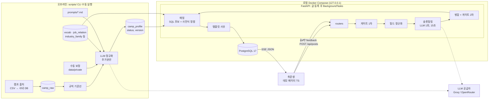

# 00. 프로젝트 개요

> 문서 상태: ✅ 완료 (2026-11-25)
> 이 문서가 가장 먼저 작성되어야 한다. 뒤 문서들의 추천 기준이 된다.

## 1. 기본 정보

### 프로젝트명
- 상태: ✅ 결정
- 결정: BootQ
- 결정일: 2026-11-24

### 한 줄 소개
- 상태: ✅ 결정
- 결정: 자연어 질의 의도 분석 기반 맞춤형 부트캠프 매칭 에이전트. 취준생이 커뮤니티 Q&A에 고민 글을 올리면 **직후** 맞는 직무 부트캠프를 최대 3개 추천해 우측 하단 토스트로 보여준다.
- 결정일: 2026-11-24

### 배경 / 만들려는 이유
- 상태: ✅ 결정
- 결정:
  - 인턴십(팀 프로젝트)에서 같은 문제를 다뤘고, 그 결론을 바탕으로 **개인 프로젝트로 재설계**한다. 인턴십 코드는 참고만 하고 복사하지 않는다.
  - 인턴십 구조(LLM 슬롯필링 + 룰 매칭 → LLM이 캠프 전체 목록에서 선택 + 룰 검증)에서 확인한 문제:
    - 캠프 전체 목록을 매 요청 LLM 입력에 넣어 요청당 토큰·응답 시간이 컸다
    - 직무가 다른 캠프가 섞이는 오류를 막으려고 룰과 예외가 계속 늘어났다
    - 가중합 적합도 점수가 좁은 구간에 몰려 품질을 구분하지 못했다
  - **근본 원인은 비교 로직이 아니라 데이터 어휘**였다. 캠프 쪽이 정규화되지 않은 코드 문자열끼리 비교했다. → 유저와 캠프가 같은 공통 어휘를 쓰도록 캠프를 오프라인에서 정규화한다.
- 결정일: 2026-11-24

## 2. 목표

### 최종 산출 목표
- 상태: ✅ 결정
- 선택지: 개인 사용 도구 / 포트폴리오 / 사이드 프로젝트(수익화) / SaaS 서비스 / 사내 시스템
- 결정: 포트폴리오 — 동작하는 MVP + 정답 셋 기반 평가 결과
- 이유: 면접에서 "어떤 로직으로 도나요?", "왜 이렇게 설계했나요?"에 답할 수 있어야 한다. 그래서 모든 설계 판단은 대안과 근거를 함께 기록한다.
- 결정일: 2026-11-24

### 성공 지표 (측정 가능한 숫자로)
- 상태: ✅ 결정
- 측정 항목: `docs/EVAL.md` — 슬롯 정확도(직무·산업)와 매칭 정확도(Hit@3, Precision@3, 추천 없음 정답률)를 분리해서 잰다. 3갈래 비교(① 규칙+수동 / ② 규칙+수동+LLM 정규화 / ③ LLM 캠프 선택)
- 결정: **③(같은 모델의 LLM 캠프 선택) 대비 상대 목표** — 아래를 모두 만족하면 성공
  1. 정확도: ②의 Hit@3가 ③ 이상 (1문항 차이까지 허용)
  2. 비용: ②의 요청당 토큰이 ③의 1/10 이하
  3. 응답 시간: 글 등록 → 토스트 표시 중앙값 5초 이하
  4. 정밀도: 추천 없음이 정답인 질문에 추천을 낸 건수 0건
- 이유:
  - 정답 셋이 작아(결정 당시 18문항, 지금 23문항) 1문항이 약 5%p — 절대 퍼센트 목표는 1~2문항 차이로 성패가 갈린다
  - 프로젝트의 주장("정규화하면 LLM 전체 선택만큼 맞히면서 훨씬 싸고 빠르다")을 같은 모델끼리 숫자로 보여줄 수 있다
  - 정밀도 > 재현율 원칙을 별도 목표로 드러낸다
  - 목표는 시스템 결과를 보기 전에 고정한다 (정답 셋을 먼저 판정하는 것과 같은 이유)
- 참고: ③은 공급자가 달라(OpenRouter) 응답 시간은 ③과 직접 비교하지 않는다. 3번은 ② 단독 목표다
- 결정일: 2026-11-24

## 3. 범위

### 포함 범위 (이번에 만드는 것)
- 상태: ✅ 결정
- 결정:
  - 오프라인 캠프 정규화: 공통 어휘(대표 직무·산업·계열·스킬), 캠프 프로파일(규칙 기준선 + LLM 추가분 + 수동 보정), diff 검수
  - 증분 정규화: 캠프 등록 시점 처리, 멱등 실행, 검수 상태(status)와 정규화 버전 저장
  - 요청 파이프라인: 2단 게이트 → 필드 정규화 → 슬롯필링(LLM 1회) → 병합 → 매칭(SQL 후보 조회 + 사전식 정렬) → 템플릿 사유 → SSE 전달
  - 토스트 데모 페이지(1~3장)와 카드별 👍/👎 피드백
  - 평가: 정답 셋(재작성 질문 23개, `EVAL.md`), 3갈래 비교, 계열 포함/제외 비교
- 결정일: 2026-11-24

### 제외 범위 (이번에 만들지 않는 것)
- 상태: ✅ 결정
- 결정:
  - 임베딩 유사도 정렬 (캠프명이 짧아 신호가 약함. 평가에서 동점이 많이 남으면 재검토)
  - 관리자 화면 (status 컬럼과 스크립트 재실행으로 데모)
  - 메시지 큐 (FastAPI BackgroundTasks 사용. 재시작 시 유실·재시도 없음은 한계로 문서화)
  - 실제 사내 캠프 DB 연동 (출처 읽기 함수 하나만 추가하면 되도록 경계만 둔다)
  - 멘토 답변(answers) 사용 (질문 직후 노출이라 답변이 아직 없음)
  - LLM 재정렬 (탈출구: 정답이 후보 안에 있는데 순위에서 밀리는 사례가 많을 때만 SQL 상위 10개 안에서 추가)
- 결정일: 2026-11-24

## 4. 사용자 정의

### 주 사용자 / 대상
- 상태: ✅ 결정
- 결정:
  - 최종 사용자: 커뮤니티 Q&A에 취업 고민 글을 올리는 취준생
  - 운영 사용자: 캠프 정규화 결과를 검수하는 사람 (MVP에서는 개발자 본인)
- 결정일: 2026-11-24

### 예상 사용자 규모 (동시 접속 등)
- 상태: ✅ 결정
- 결정: 데모·평가용 로컬 실행, **동시 사용자 1명**. 부하 대응은 설계하지 않는다 (BackgroundTasks + 단일 프로세스)
- 이유:
  - 상한은 사용자 수가 아니라 LLM 무료 한도(05_AI.md: 1K RPD, 8K TPM)가 정한다
  - 공개 데모는 외부 입력이 무료 LLM 티어로 흘러가 "실제 유저 글을 무료 티어에 보내지 않는다" 원칙과 충돌
  - 실서비스 확장(큐, 재시도, 수평 확장)은 한계·확장 방향으로만 문서화한다
- 결정일: 2026-11-24

### 핵심 유저 스토리
- 상태: ✅ 결정
- 결정:
  1. 취준생으로서, 내 고민에 맞는 준비 수단을 찾기 위해, 글을 올린 직후 내 직무·산업에 맞는 부트캠프 추천을 토스트로 본다.
  2. 취준생으로서, 추천이 왜 나왔는지 납득하기 위해, 카드마다 내 글의 어떤 부분을 근거로 했는지 본다.
  3. 취준생으로서, 엉뚱한 광고를 보지 않기 위해, 직무·산업 신호가 없는 글에는 아무 추천도 받지 않는다.
  4. 취준생으로서, 추천 품질 개선에 기여하기 위해, 카드마다 👍/👎와 👎 사유를 남긴다.
  5. 검수자로서, 검수 부담을 줄이기 위해, LLM 정규화 결과가 기존 코드와 달라진 캠프만 검수한다.
  6. 개발자로서, 설계 판단을 증명하기 위해, DB·LLM 없이 고정 데이터로 매칭 정확도를 재계산한다.
- 우선순위: **1·3 → 6 → 2·4 → 5**
  - 1·3: 핵심 가치이자 정밀도 지표
  - 6: 평가의 전제
  - 2·4: MVP는 템플릿 사유, 피드백은 저장만
  - 5: 스크립트로 이미 진행 중
- 결정일: 2026-11-25

## 5. 개발 형태

### 개발 인원
- 상태: ✅ 결정
- 선택지: 혼자 / 협업 (인원수, 역할 분담 기재)
- 결정: 혼자
- 이유: 인턴십 팀 작업과 구분되는 개인 재설계 프로젝트
- 결정일: 2026-11-24

### 목표 일정 (대략)
- 상태: ✅ 결정
- 결정: **2026-11-27까지 MVP + 평가 결과** (원래 목표 "하루 안에"에서 3일로 조정)
  - 11/24: 정규화(오프라인 산출물)와 평가 설계 — 완료
  - 11/25: 정규화 마무리 + 매칭 core + 평가 스크립트
  - 11/26: DB·API·SSE + 데모 페이지
  - 11/27: 3갈래 평가 실행 + 결과·문서(README) 정리
- 이유: Groq 일일 한도(200K TPD) 때문에 정규화·평가 LLM 호출이 하루를 넘길 수 있어 여유를 둔다
- 결정일: 2026-11-25

## 6. 시스템 구성도 (블루프린트)

> 전체 시스템의 큰 그림. 규칙 문서(01~08)의 결정이 끝나면 AI가 mermaid로 작성하고 사용자 확인을 받는다.

- 상태: ✅ 결정
- 결정일: 2026-11-25

### 구성 요소 설명
| 구성 요소 | 역할 | 비고 |
|---|---|---|
| 캠프 출처 → camp_raw | 출처 데이터를 주기적으로 복제 | 요청 시점에 출처를 직접 조회하지 않는다 |
| 규칙 기준선 / LLM 정규화 / 수동 보정 | 캠프를 공통 어휘로 정규화 | 적용 순서: 수동 보정 > LLM > 규칙 |
| camp_profile | 매칭이 보는 유일한 캠프 데이터 | 승인 전 캠프는 기존 코드 기준으로만 후보 |
| 게이트 (2단) | 비대상 글 컷 | 추천 없음 = 토스트를 띄우지 않음 |
| 슬롯필링 | 글에서 직무·산업·원하는 도움 추출 | 출력은 vocab Enum으로 강제 |
| 매칭 | 후보 조회(SQL) + 정렬(순수 함수, 사전식) | 가중합 쓰지 않음 |
| 데모 페이지 | 글 입력 + 토스트 + 피드백. 정적 HTML + TS, FastAPI가 같은 출처로 서빙 | 03_FRONTEND.md |
| PostgreSQL 17 | 어휘·캠프·글·추천·피드백 저장. 순수 SQL + psycopg 3 비동기 | 04_DATABASE.md |
| LLM 공급자 | Groq(메인), OpenRouter(평가 ③) — 같은 `gpt-oss-120b` | 05_AI.md |
| 실행 환경 | 로컬 Docker Compose만, API는 127.0.0.1에만 게시, 인증 없음 | 06_INFRA_DEPLOY.md |
