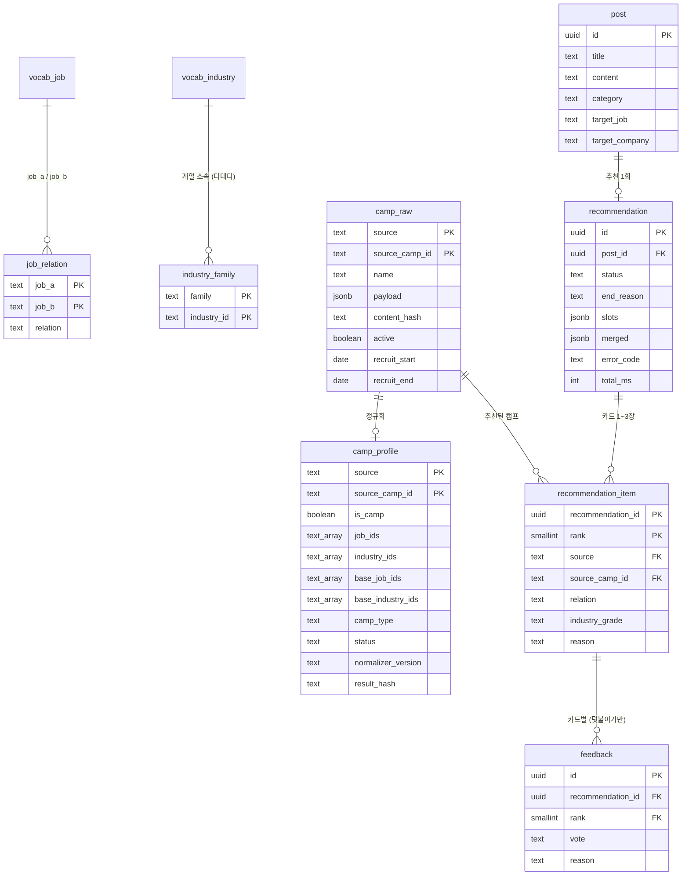

# 04. 데이터베이스 설계

> 문서 상태: ✅ 완료 (2026-11-25) — 3~4장(ERD·테이블 정의서)은 산출물로 계속 갱신
> 1~2장(규칙)은 개발 시작 전에 결정. 3~4장(ERD·테이블 정의서)은 산출물로, 개발하면서 계속 갱신한다.
> 사전 기입(2026-11-24): DBMS 종류, 데이터 접근 방식, 테이블 목록은 기존 설계 메모에서 옮겼다.
> 2026-11-26(#13): 컬럼 상세 작성, `db/migrations/001_init.sql` 생성 — 이후 스키마 원본은 SQL 파일.

## 1. 기본 규칙

### DBMS / 버전
- 상태: ✅ 결정
- 결정: PostgreSQL 17 (`postgres:17`) — 01_TECH_STACK.md와 동일
- 결정일: 2026-11-25

### ORM / 데이터 접근 방식
- 상태: ✅ 결정
- 선택지 예: JPA(Hibernate) / MyBatis / Prisma / Drizzle / SQLAlchemy / 순수 SQL
- 결정: **순수 SQL, ORM 없음** + 드라이버 **psycopg 3 비동기**(`psycopg.AsyncConnection`, 커넥션 풀은 `psycopg_pool.AsyncConnectionPool`). `repositories/`에서 SQL을 직접 작성하고 dataclass로 반환한다
- 이유:
  - 순수 SQL: 매칭 후보 조회가 job_relation 조인·등급 집합 조건이라 SQL로 직접 보이는 편이 설명·튜닝이 쉽다
  - 비동기: FastAPI async 엔드포인트·SSE와 자연스럽게 맞는다 (사용자 선택. AI 추천은 동기였음 — 동시 1명이고 병목이 LLM이라는 이유)
- 따라오는 규칙:
  - repositories·services는 `async def`. core는 그대로 동기 순수 함수
  - **LLM 클라이언트는 동기(표준 라이브러리 `urllib`)이므로 services에서 `asyncio.to_thread`로 호출**해 이벤트 루프를 막지 않는다 (llm/ 코드는 바꾸지 않음)
  - DB를 쓰는 스크립트는 `asyncio.run`으로 진입
- 결정일: 2026-11-25

### 마이그레이션 도구
- 상태: ✅ 결정
- 선택지 예: Flyway / Liquibase / Prisma Migrate / Alembic / 없음(초기엔 ddl-auto)
- 결정: **번호 붙인 SQL 파일**(`db/migrations/001_init.sql` …) + 적용 이력 테이블(`schema_migration`)을 보는 짧은 적용 스크립트
- 이유: ORM이 없어 Alembic의 자동 생성 이점이 없고, 데모 규모라 도구 의존을 늘리지 않는다
- 원본 규칙: 첫 마이그레이션 파일을 만든 시점부터 **스키마 원본은 SQL 파일**이다 (4장 참고)
- 적용 스크립트 규칙 (2026-11-26, #13):
  - `uv run python scripts/migrate.py [--database-url URL]` — 기본은 `.env`의 `DATABASE_URL`
  - `db/migrations/`의 `NNN_이름.sql`을 번호 순서로 보고, `schema_migration`에 없는 파일만 **파일마다 트랜잭션 하나**로 적용하고 이력을 남긴다 (실패하면 그 파일만 롤백되고 멈춤)
  - 이미 적용한 파일의 checksum이 바뀌었으면 아무것도 적용하지 않고 멈춘다. 적용한 파일은 고치지 않고 새 번호로 추가한다
  - 되돌리기(down) 파일은 두지 않는다 — 로컬 데모라 DB를 지우고 다시 만드는 편이 단순하다 (`docker compose down -v`)
  - 동시에 두 번 실행하는 경우를 막기 위해 적용 중에는 advisory lock을 잡는다 (API 컨테이너 시작과 수동 실행이 겹칠 수 있음)
- 결정일: 2026-11-25

## 2. 네이밍 및 공통 규칙

### 네이밍 규칙
- 상태: ✅ 결정
- 결정: 테이블·컬럼 snake_case, 테이블명 **단수형**(camp_raw, post, recommendation, feedback …). FK는 `{참조 테이블}_id`
- 결정일: 2026-11-25

### 공통 컬럼
- 상태: ✅ 결정
- 결정: 모든 테이블에 `created_at`, 갱신되는 테이블(camp_raw, camp_profile)에만 `updated_at`. 소프트 삭제 없음 — 대신 camp_raw의 `active` 플래그(출처에서 사라진 캠프는 비활성)
- 결정일: 2026-11-25

### PK 전략
- 상태: ✅ 결정
- 선택지: Auto Increment / UUID / ULID
- 결정:
  - camp_raw: **`(source, source_camp_id)`**. CSV에는 ID가 없어 캠프명 해시로 임시 ID를 만든다(직무코드는 넣지 않음 — 같은 캠프가 코드만 다른 여러 행으로 들어 있어 두 번 추천될 수 있음). 추천 로그·피드백은 캠프명이 아니라 이 ID로 연결
  - 어휘·관계 테이블: 사람이 읽는 **문자열 ID** (CSV에서 이미 쓰는 값)
  - post·recommendation·feedback: **UUID** — DB 기본값 `gen_random_uuid()`(UUIDv4, PostgreSQL 17 내장). 시간 순 정렬은 `created_at`으로
- 이유: rec_id·post_id가 URL에 노출되므로 순번 추측을 막는다 (사용자 선택. AI 추천은 bigint identity였음 — 로컬 데모라 이점이 작다는 이유)
- 결정일: 2026-11-25

### 트랜잭션 / 동시성 방침
- 상태: ✅ 결정
- 결정:
  - 트랜잭션 경계는 **services 계층**
  - **LLM 호출 중에는 트랜잭션을 열어두지 않는다** (글 저장 커밋 → LLM 호출 → 결과 저장 커밋). 중간 실패 시 성공 단계 결과를 남기는 원칙과 맞물림
  - 정규화 스크립트는 **캠프 단위로 커밋** (중간 실패해도 처리한 캠프는 유지, 해시로 멱등)
  - 잠금은 기본값 (동시 쓰기 대상이 없음)
- 결정일: 2026-11-25

---

## 3. ERD (산출물 — 개발하며 갱신)

> 테이블 추가/변경 시 이 다이어그램을 같은 작업 안에서 갱신한다. 2026-11-26 `001_init.sql` 기준.
> 어휘 테이블은 서로 관계만 적었다. 캠프·유저 쪽의 직무·산업 배열(`text[]`)은 배열이라 FK를 걸 수 없고, 적재 배치(BAT-006)가 어휘에 있는 값인지 검사한다.

## 4. 테이블 정의서 (산출물 — 개발하며 갱신)

> **문서 원본(source of truth) 규칙**: 마이그레이션 도구를 도입한 시점부터 스키마의 원본은 **마이그레이션 파일(코드)**이다.
> 그 이후 이 문서에는 테이블 목록·설계 의도·컬럼 설명(왜 이 컬럼이 필요한가)만 유지하고, 정확한 타입·제약은 마이그레이션 파일을 참조한다.
> 마이그레이션 도구가 없는 프로젝트는 이 문서가 끝까지 원본이다.
>
> **2026-11-26부터 원본은 `db/migrations/*.sql`이다** (`001_init.sql`). 아래 표는 그 시점의 설계 의도를 적은 것이고, 타입·제약이 다르면 SQL이 맞다.
>
> 마이그레이션 이력: `001_init.sql`(#13) → `002_vocab_temporary_feedback_reason.sql`(#14: vocab_job.temporary, 어휘 position, feedback.reason 코드 제약)

### 테이블 목록

| 테이블명 | 설명 | 상태 |
|---|---|---|
| vocab_job | 대표 직무 어휘 (같은 일을 하는 원래 직무는 합침). 원본 `data/vocab/jobs.csv` | 생성 |
| vocab_industry | 대표 산업 어휘. 원본 `data/vocab/industries.csv` | 생성 |
| vocab_skill | 스킬 어휘. 원본 `data/vocab/skills.csv` (2026-11-25 추가) | 생성 |
| industry_family | 산업 → 계열 **집합** (한 산업이 여러 계열에 속할 수 있음). 원본 `data/vocab/industry_family.csv` | 생성 |
| job_relation | 직무 쌍 관계 CLOSE / FAMILY (자기 자신은 항상 SAME이라 저장하지 않음). CLOSE는 "사실상 같은 일"로 좁게. 생성 파일 `data/vocab/job_relation.csv` ← `jobs.csv` + `job_family_policy.csv`(대분류별 자동 FAMILY) + `job_relation_manual.csv`(수동, NONE은 삭제), 생성 `scripts/build_job_relation.py` | 생성 |
| job_alias | 유저 target_job 자유 표기 → 대표 직무(+산업). 대표 직무와 같은 표기는 넣지 않음(바로 일치). 직무가 빈 행은 "본문으로 판단". 원본 `data/private/job_alias.csv`(git 제외) | 생성 |
| company_industry | 유저 target_company → 산업(여러 개 가능). 미지정·회사 아님은 빈 값. 원본 `data/private/company_industry.csv`(git 제외) | 생성 |
| category_camp_type | question_category → camp_type 기본값 (desired_help가 UNKNOWN일 때만 병합 결과에 넣음, 빈 값 = 선호 없음). 정렬 4단계는 본문 출처만 쓰므로 지금은 매칭에 쓰이지 않는다(2026-11-25, #35, `02_BACKEND.md` 5장). 원본 `data/vocab/category_camp_type.csv` | 생성 |
| camp_raw | 출처 원본 복제. 원본 행 전체를 JSONB `payload`로 (출처에 새 필드가 생겨도 스키마가 깨지지 않게), 내용 해시로 멱등 처리, `active` | 생성 |
| camp_profile | 정규화 결과. `status`(auto_approved / pending_review / approved), `normalizer_version` | 생성 |
| post | 유저 글 | 생성 |
| recommendation | 추천 1회의 처리 기록. 슬롯 JSON은 JSONB, 처리시간·토큰·오류코드 | 생성 |
| recommendation_item | 추천 카드 한 장 (2026-11-26 추가) | 생성 |
| feedback | 카드별 피드백: rec_id, 캠프, 순위, 👍/👎, 👎 사유 | 생성 |
| schema_migration | 적용한 마이그레이션 파일 이력 | 생성 |

> 어휘·관계 테이블(vocab_*, job_relation, industry_family, job_alias, company_industry, category_camp_type)은 서버 시작 시 메모리 로드, `/api/admin/vocab/reload`로 재로드.
> 어휘 테이블의 원본은 여전히 파일(`data/vocab/`, `data/private/`)이고 DB는 적재본이다 (BAT-006이 비우고 다시 넣음). 그래서 어휘 테이블에는 파일의 `status`·`reason`·`note` 같은 검토용 칸을 옮기지 않는다.

### 공통 설계 의도

- **값 집합은 `CHECK`로**: status·relation·vote 같은 짧은 값 목록은 enum 타입 대신 `text + CHECK`. 값을 추가할 때 `ALTER TYPE` 없이 제약만 바꾸면 되고, 코드의 문자열 상수와 그대로 맞는다
- **배열은 `text[]`, FK 없음**: 캠프·유저 쪽 직무·산업 목록은 순서가 있는 작은 집합이라 배열로 둔다 (core의 `tuple[str, ...]`와 1:1). 어휘에 있는 값인지는 적재 배치와 core 검증 함수가 확인한다
- **인덱스는 PK·UNIQUE·FK 조회용만**: 캠프가 수백 개라 매칭 후보 조회는 순차 스캔으로 충분하다. GIN 인덱스는 측정해서 느릴 때만
- 시각은 `timestamptz`, 기본값 `now()`

### 테이블 상세

#### `schema_migration`
- 설명: 적용한 마이그레이션 파일 이력. 적용 스크립트(`scripts/migrate.py`)가 만들고 읽는다
- 관련 기능: 마이그레이션 적용

| 컬럼명 | 타입 | Null | 기본값 | 제약/인덱스 | 설명 |
|---|---|---|---|---|---|
| version | text | NO | | PK | 파일 이름 앞 번호 (`001`) |
| filename | text | NO | | | 파일 이름 (`001_init.sql`) |
| checksum | text | NO | | | 파일 내용 SHA-256. 이미 적용한 파일을 고치면 스크립트가 멈춘다 (적용된 파일은 고치지 않고 새 번호로 추가) |
| applied_at | timestamptz | NO | now() | | 적용 시각 |

#### 어휘 테이블 (`vocab_job`, `vocab_industry`, `vocab_skill`, `industry_family`, `job_relation`, `job_alias`, `company_industry`, `category_camp_type`)
- 설명: 파일 어휘의 적재본. 모두 `created_at` 포함
- 관련 기능: 슬롯필링 Enum 생성, 필드 정규화, 매칭(직무 등급·산업 등급), BAT-006

| 테이블 | 컬럼 | 제약 | 설명 |
|---|---|---|---|
| vocab_job | job_id text, family text, temporary boolean, position integer | PK(job_id) | 대표 직무와 대분류(계열 정책 단위). `temporary`는 jobs.csv의 `임시`(자리표시 직무, 재분류 후 삭제 예정) — 캠프가 쓰고 있어 넣되 슬롯필링 선택지에서는 뺀다 (002, 2026-11-26) |
| vocab_industry | industry_id text, position integer | PK | `ANY` 포함. `position`은 파일 순서 (002: 슬롯필링 프롬프트의 Enum 순서가 평가와 같아야 해서) |
| vocab_skill | skill_id text | PK | |
| industry_family | family text, industry_id text | PK(family, industry_id), FK industry_id → vocab_industry | 한 산업이 여러 행 → 계열 집합 |
| job_relation | job_a text, job_b text, relation text, source text | PK(job_a, job_b), FK 양쪽 → vocab_job, `relation IN ('CLOSE','FAMILY')`, `source IN ('auto','manual')`, `job_a <> job_b` | 파일에 한 방향으로만 저장되어 있고 대칭으로 읽는다 (core.job_relation). 역방향 중복은 적재 배치가 막는다 |
| job_alias | user_term text, job_ids text[], industry_id text | PK(user_term) | job_ids가 빈 배열이면 "본문으로 판단" |
| company_industry | company text, industry_ids text[] | PK(company) | 빈 배열 = 회사 아님·산업 판단 불가 |
| category_camp_type | category text, camp_type text | PK(category), camp_type은 아래 값 또는 NULL | NULL = 선호 없음 |

#### `camp_raw`
- 설명: 출처(지금은 CSV, 나중엔 사내 DB) 원본 복제. 매칭은 이 테이블을 직접 보지 않고 camp_profile을 본다
- 관련 기능: BAT-001·BAT-006(적재), 매칭 0단계(모집 중), 추천 카드의 캠프명 표시

| 컬럼명 | 타입 | Null | 기본값 | 제약/인덱스 | 설명 |
|---|---|---|---|---|---|
| source | text | NO | | PK | 출처 이름 (`csv` …) |
| source_camp_id | text | NO | | PK | 출처의 캠프 ID. CSV는 캠프명 해시 (1장 PK 전략) |
| name | text | NO | | | 캠프명. 카드 표시·사유에 자주 쓰여 payload에서 꺼내 둔다 |
| payload | jsonb | NO | | | 원본 행 전체의 배열 (같은 캠프가 직무코드만 다른 여러 행이면 모두. ID 칸 제외) |
| content_hash | text | NO | | | 캠프명+원래 코드 해시. 바뀐 캠프만 재정규화 |
| active | boolean | NO | true | | 출처에서 사라지면 false (소프트 삭제 대신) |
| recruit_start | date | YES | | | 모집 시작일. 출처에 없으면 NULL |
| recruit_end | date | YES | | `recruit_start <= recruit_end` | 모집 마감일. NULL이면 모집 중으로 본다 (매칭 0단계) |
| created_at / updated_at | timestamptz | NO | now() | | |

#### `camp_profile`
- 설명: 정규화 결과 (BAT-003 산출물 `camp_profile_draft.csv`와 같은 칸). 결과 칸과 기준 칸을 둘 다 둔다 — pending_review는 승인 전이라 매칭에 기준 칸을 쓰기 때문이다. 어느 칸을 쓸지는 SQL이 아니라 `core.models.camp_for_matching`이 정한다 (규칙을 한 곳에)
- 관련 기능: 매칭 후보, 검수 상태 데모(status 컬럼 + 스크립트 재실행)

| 컬럼명 | 타입 | Null | 기본값 | 제약/인덱스 | 설명 |
|---|---|---|---|---|---|
| source, source_camp_id | text | NO | | PK, FK → camp_raw ON DELETE CASCADE | camp_raw와 1:1 |
| is_camp | boolean | NO | true | | 캠프 아님 판정(취업컨설팅 등)이면 false |
| job_ids | text[] | NO | '{}' | | 정규화 결과 직무 (첫 값이 주 직무) |
| sub_job | text | YES | | | 하위 직무 |
| industry_ids | text[] | NO | '{}' | | 정규화 결과 산업. 산업무관은 `{ANY}` |
| skills | text[] | NO | '{}' | | |
| tags | text[] | NO | '{}' | | 매칭에 쓰지 않는 표시용 (예: 이커머스) |
| camp_type | text | YES | | `EXPLORE / EXPERIENCE / APPLICATION` | |
| base_job_ids, base_industry_ids, base_sub_jobs, base_skills | text[] | NO | '{}' | | 규칙 기준선 + 수동 보정 값 (pending_review의 매칭, 평가 변형 ①) |
| remove_industry_suggested | boolean | NO | false | | LLM이 기준 산업을 ANY로 바꾸자고 제안함 (제안만) |
| evidence | jsonb | NO | '[]' | | LLM이 낸 캠프명 근거 구절 |
| status | text | NO | | `auto_approved / pending_review / approved` | BAT-003 4번 표 |
| normalizer_version | text | NO | | | 버전이 바뀌면 전체 재실행 후 diff만 검수 |
| content_hash | text | NO | | | 이 결과를 만든 camp_raw.content_hash. 다르면 재정규화 대상 |
| result_hash | text | NO | | | 검수 승인이 묶이는 결과 해시 |
| created_at / updated_at | timestamptz | NO | now() | | |

#### `post`
- 설명: 유저 글. 데모·테스트에는 재작성 샘플만 넣는다. 본문·제목은 로그에 남기지 않는다(02_BACKEND.md)
- 관련 기능: API-001 글 등록, 게이트 1차, 슬롯필링

| 컬럼명 | 타입 | Null | 기본값 | 제약/인덱스 | 설명 |
|---|---|---|---|---|---|
| id | uuid | NO | gen_random_uuid() | PK | URL에 노출 |
| title | text | NO | | | |
| content | text | NO | | | |
| category | text | NO | '' | | question_category (게이트·camp_type 기본값) |
| category_group | text | NO | '' | | question_category_group (게이트 1차) |
| target_job | text | NO | '' | | 입력 필드 원문. '모든 직무'도 그대로 저장하고 정규화는 코드가 |
| target_company | text | NO | '' | | 입력 필드 원문 |
| created_at | timestamptz | NO | now() | | |

#### `recommendation`
- 설명: 글 하나에 대한 추천 처리 1회. 결과 0개·게이트 종료·LLM 오류도 행이 남는다(수요 부족·오류 분석용). SSE는 이 행의 status를 보고 결과를 보낸다
- 관련 기능: API-001(행 생성), 백그라운드 파이프라인(갱신), API-002 SSE

| 컬럼명 | 타입 | Null | 기본값 | 제약/인덱스 | 설명 |
|---|---|---|---|---|---|
| id | uuid | NO | gen_random_uuid() | PK | rec_id |
| post_id | uuid | NO | | FK → post ON DELETE CASCADE, UNIQUE | 글당 1회 |
| status | text | NO | 'processing' | `processing / done / failed` | failed = 오류코드가 있는 종료 |
| end_reason | text | YES | | | 추천 없이 끝난 이유 (게이트 1차·2차, 후보 없음 등). 값 목록은 #14에서 코드 상수로 |
| slots | jsonb | YES | | | 슬롯필링 원본 출력 (검증 전 포함). 중간 실패해도 성공한 단계 결과는 남긴다 |
| merged | jsonb | YES | | | 병합 결과 (직무·산업 후보, 출처, 플래그) |
| flags | text[] | NO | '{}' | | 리뷰 플래그 (family_used, industry_only, job_conflict …) |
| error_code | text | YES | | | LLM 오류코드 (02_BACKEND.md 4장). `status='failed'`면 필수 |
| model | text | YES | | | 슬롯필링에 쓴 모델 |
| prompt_tokens / completion_tokens | integer | YES | | | |
| stage_ms | jsonb | NO | '{}' | | 단계별 처리시간 (recorder) |
| total_ms | integer | YES | | | |
| created_at | timestamptz | NO | now() | | |
| completed_at | timestamptz | YES | | `status='processing'`이면 NULL | |

#### `recommendation_item`
- 설명: 토스트에 보여준 카드 한 장. 별도 테이블로 둔 이유: 피드백이 FK로 "실제로 보여준 카드"만 가리키게 하고, 👎와 매칭 근거(직무 관계·산업 등급)를 SQL 조인으로 분석하기 위해 (대안 `recommendation.items` JSONB는 이 검사를 서비스 코드에 맡겨야 함, 2026-11-26)
- 관련 기능: 파이프라인 7단계(결과 저장), API-002, API-003

| 컬럼명 | 타입 | Null | 기본값 | 제약/인덱스 | 설명 |
|---|---|---|---|---|---|
| recommendation_id | uuid | NO | | PK, FK → recommendation ON DELETE CASCADE | |
| rank | smallint | NO | | PK, `1~3` | 표시 순서 |
| source, source_camp_id | text | NO | | FK → camp_raw, UNIQUE(recommendation_id, source, source_camp_id) | 같은 추천에 같은 캠프 두 번 금지 |
| job_id | text | YES | | | 맞춘 유저 직무 (산업만 매칭이면 NULL) |
| camp_job_id | text | YES | | | 관계를 만든 캠프 직무 |
| relation | text | YES | | `SAME / CLOSE / FAMILY` | |
| industry_id / camp_industry_id | text | YES | | | 산업 등급을 만든 유저·캠프 산업 |
| industry_grade | text | YES | | | core `IndustryGrade` 이름. NULL이면 산업 단계 건너뜀 |
| help_grade | text | YES | | | core `HelpGrade` 이름. NULL이면 4단계 건너뜀 |
| review | boolean | NO | false | | B등급 또는 산업만 매칭 |
| guaranteed | boolean | NO | false | | 복수 직무 분배로 자리 보장 |
| reason | text | NO | | | 카드 사유 문장 (템플릿) |
| created_at | timestamptz | NO | now() | | |

> UNIQUE(recommendation_id, rank, source, source_camp_id)를 따로 둔다 — feedback의 복합 FK 대상 (PK의 상위 집합이지만 FK는 정확히 같은 열의 UNIQUE가 필요하다)

#### `feedback`
- 설명: 카드별 👍/👎. **덧붙이기만 한다** (수정·삭제 없음, 같은 카드에 여러 번 누르면 행이 쌓이고 최신 `created_at`이 현재 의견). 갱신 테이블이 아니라 `updated_at`이 없다
- 관련 기능: API-003

| 컬럼명 | 타입 | Null | 기본값 | 제약/인덱스 | 설명 |
|---|---|---|---|---|---|
| id | uuid | NO | gen_random_uuid() | PK | |
| recommendation_id, rank, source, source_camp_id | | NO | | 복합 FK → recommendation_item ON DELETE CASCADE, 인덱스 | rec_id + 순위 + 캠프가 실제 보여준 카드와 맞아야 들어간다 |
| vote | text | NO | | `up / down` | |
| reason | text | YES | | `vote='down'`일 때만, 코드 `job_mismatch / industry_mismatch / not_needed / other` (002) | 👎 사유 코드. 자유 입력은 받지 않는다 (10_API_SPEC.md API-003, 2026-11-26) |
| created_at | timestamptz | NO | now() | | |
