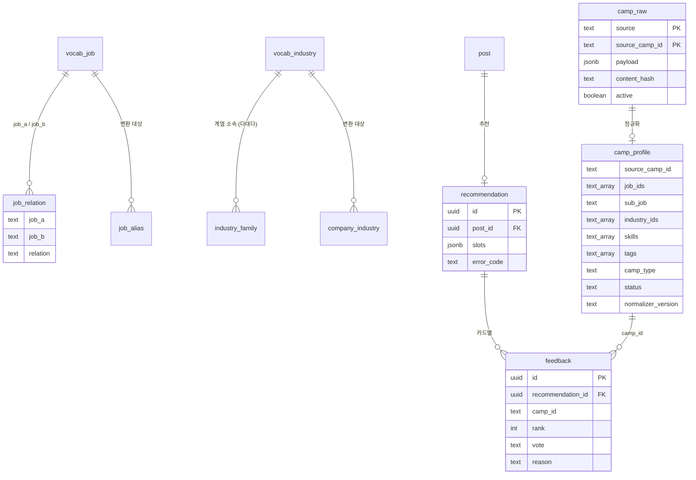

# 04. 데이터베이스 설계

> 문서 상태: ✅ 완료 (2026-11-25) — 3~4장(ERD·테이블 정의서)은 산출물로 계속 갱신
> 1~2장(규칙)은 개발 시작 전에 결정. 3~4장(ERD·테이블 정의서)은 산출물로, 개발하면서 계속 갱신한다.
> 사전 기입(2026-11-24): DBMS 종류, 데이터 접근 방식, 테이블 목록은 기존 설계 메모에서 옮겼다. 컬럼 상세는 아직 설계 전이다.

## 1. 기본 규칙

### DBMS / 버전
- 상태: ✅ 결정
- 결정: PostgreSQL 17 (`postgres:17`) — 01_TECH_STACK.md와 동일
- 결정일: 2026-11-25

### ORM / 데이터 접근 방식
- 상태: ✅ 결정
- 선택지 예: JPA(Hibernate) / MyBatis / Prisma / Drizzle / SQLAlchemy / 순수 SQL
- 결정: **순수 SQL, ORM 없음** + 드라이버 **psycopg 3 비동기**(`psycopg.AsyncConnection`, 커넥션 풀은 `psycopg_pool.AsyncConnectionPool`). `repositories/`에서 SQL을 직접 작성하고 dataclass로 반환한다
- 이유:
  - 순수 SQL: 매칭 후보 조회가 job_relation 조인·등급 집합 조건이라 SQL로 직접 보이는 편이 설명·튜닝이 쉽다
  - 비동기: FastAPI async 엔드포인트·SSE와 자연스럽게 맞는다 (사용자 선택. AI 추천은 동기였음 — 동시 1명이고 병목이 LLM이라는 이유)
- 따라오는 규칙:
  - repositories·services는 `async def`. core는 그대로 동기 순수 함수
  - **LLM 클라이언트는 동기(표준 라이브러리 `urllib`)이므로 services에서 `asyncio.to_thread`로 호출**해 이벤트 루프를 막지 않는다 (llm/ 코드는 바꾸지 않음)
  - DB를 쓰는 스크립트는 `asyncio.run`으로 진입
- 결정일: 2026-11-25

### 마이그레이션 도구
- 상태: ✅ 결정
- 선택지 예: Flyway / Liquibase / Prisma Migrate / Alembic / 없음(초기엔 ddl-auto)
- 결정: **번호 붙인 SQL 파일**(`db/migrations/001_init.sql` …) + 적용 이력 테이블(`schema_migration`)을 보는 짧은 적용 스크립트
- 이유: ORM이 없어 Alembic의 자동 생성 이점이 없고, 데모 규모라 도구 의존을 늘리지 않는다
- 원본 규칙: 첫 마이그레이션 파일을 만든 시점부터 **스키마 원본은 SQL 파일**이다 (4장 참고)
- 결정일: 2026-11-25

## 2. 네이밍 및 공통 규칙

### 네이밍 규칙
- 상태: ✅ 결정
- 결정: 테이블·컬럼 snake_case, 테이블명 **단수형**(camp_raw, post, recommendation, feedback …). FK는 `{참조 테이블}_id`
- 결정일: 2026-11-25

### 공통 컬럼
- 상태: ✅ 결정
- 결정: 모든 테이블에 `created_at`, 갱신되는 테이블(camp_raw, camp_profile)에만 `updated_at`. 소프트 삭제 없음 — 대신 camp_raw의 `active` 플래그(출처에서 사라진 캠프는 비활성)
- 결정일: 2026-11-25

### PK 전략
- 상태: ✅ 결정
- 선택지: Auto Increment / UUID / ULID
- 결정:
  - camp_raw: **`(source, source_camp_id)`**. CSV에는 ID가 없어 캠프명 해시로 임시 ID를 만든다(직무코드는 넣지 않음 — 같은 캠프가 코드만 다른 여러 행으로 들어 있어 두 번 추천될 수 있음). 추천 로그·피드백은 캠프명이 아니라 이 ID로 연결
  - 어휘·관계 테이블: 사람이 읽는 **문자열 ID** (CSV에서 이미 쓰는 값)
  - post·recommendation·feedback: **UUID** — DB 기본값 `gen_random_uuid()`(UUIDv4, PostgreSQL 17 내장). 시간 순 정렬은 `created_at`으로
- 이유: rec_id·post_id가 URL에 노출되므로 순번 추측을 막는다 (사용자 선택. AI 추천은 bigint identity였음 — 로컬 데모라 이점이 작다는 이유)
- 결정일: 2026-11-25

### 트랜잭션 / 동시성 방침
- 상태: ✅ 결정
- 결정:
  - 트랜잭션 경계는 **services 계층**
  - **LLM 호출 중에는 트랜잭션을 열어두지 않는다** (글 저장 커밋 → LLM 호출 → 결과 저장 커밋). 중간 실패 시 성공 단계 결과를 남기는 원칙과 맞물림
  - 정규화 스크립트는 **캠프 단위로 커밋** (중간 실패해도 처리한 캠프는 유지, 해시로 멱등)
  - 잠금은 기본값 (동시 쓰기 대상이 없음)
- 결정일: 2026-11-25

---

## 3. ERD (산출물 — 개발하며 갱신)

> 테이블 추가/변경 시 이 다이어그램을 같은 작업 안에서 갱신한다.
> 아래는 설계 메모의 테이블 목록 기준 **초안**이다. 컬럼은 확정된 것만 적었다.

## 4. 테이블 정의서 (산출물 — 개발하며 갱신)

> **문서 원본(source of truth) 규칙**: 마이그레이션 도구를 도입한 시점부터 스키마의 원본은 **마이그레이션 파일(코드)**이다.
> 그 이후 이 문서에는 테이블 목록·설계 의도·컬럼 설명(왜 이 컬럼이 필요한가)만 유지하고, 정확한 타입·제약은 마이그레이션 파일을 참조한다.
> 마이그레이션 도구가 없는 프로젝트는 이 문서가 끝까지 원본이다.

### 테이블 목록

| 테이블명 | 설명 | 상태 |
|---|---|---|
| vocab_job | 대표 직무 어휘 (같은 일을 하는 원래 직무는 합침). 현재 `data/vocab/jobs.csv` | 설계 |
| vocab_industry | 대표 산업 어휘. 현재 `data/vocab/industries.csv` | 설계 |
| industry_family | 산업 → 계열 **집합** (한 산업이 여러 계열에 속할 수 있음). 현재 `data/vocab/industry_family.csv` | 설계 |
| job_relation | 직무 쌍 관계 CLOSE / FAMILY (자기 자신은 항상 SAME이라 저장하지 않음). CLOSE는 "사실상 같은 일"로 좁게. 생성 파일 `data/vocab/job_relation.csv` ← `jobs.csv` + `job_family_policy.csv`(대분류별 자동 FAMILY) + `job_relation_manual.csv`(수동, NONE은 삭제), 생성 `scripts/build_job_relation.py` | 설계 |
| job_alias | 유저 target_job 자유 표기 → 대표 직무(+산업). 대표 직무와 같은 표기는 넣지 않음(바로 일치). 직무가 빈 행은 "본문으로 판단". 원본 `data/private/job_alias.csv`(git 제외) | 설계 |
| company_industry | 유저 target_company → 산업(여러 개 가능). 미지정·회사 아님은 빈 값. 원본 `data/private/company_industry.csv`(git 제외) | 설계 |
| camp_raw | 출처 원본 복제. 원본 행 전체를 JSONB `payload`로 (출처에 새 필드가 생겨도 스키마가 깨지지 않게), 내용 해시로 멱등 처리, `active` | 설계 |
| camp_profile | 정규화 결과. `status`(auto_approved / pending_review / approved), `normalizer_version` | 설계 |
| post | 유저 글 | 설계 |
| recommendation | 추천 결과. 슬롯 JSON은 JSONB, 처리시간·토큰·오류코드 | 설계 |
| feedback | 카드별 피드백: rec_id, camp_id, 순위, 👍/👎, 👎 사유 | 설계 |
| vocab_skill | 스킬 어휘. 현재 `data/vocab/skills.csv` (2026-11-25 추가) | 설계 |
| category_camp_type | question_category → camp_type 기본값 (desired_help가 UNKNOWN일 때만 병합 결과에 넣음, 빈 값 = 선호 없음). 정렬 4단계는 본문 출처만 쓰므로 지금은 매칭에 쓰이지 않는다(2026-11-25, #35, `02_BACKEND.md` 5장). 원본 `data/vocab/category_camp_type.csv` (2026-11-25 추가) | 설계 |
| schema_migration | 적용한 마이그레이션 파일 이력 | 설계 |

> 어휘·관계 테이블(vocab_*, job_relation, industry_family, job_alias, company_industry, category_camp_type)은 서버 시작 시 메모리 로드, `/api/admin/vocab/reload`로 재로드.

### 테이블 상세 템플릿

> 새 테이블마다 아래 형식을 복사해 작성한다. (구현 직전에 테이블별로 작성)

#### `테이블명`
- 설명:
- 관련 기능:

| 컬럼명 | 타입 | Null | 기본값 | 제약/인덱스 | 설명 |
|---|---|---|---|---|---|
| id | | NO | | PK | |
| created_at | | NO | now() | | 생성일시 |
| updated_at | | NO | now() | | 수정일시 |
