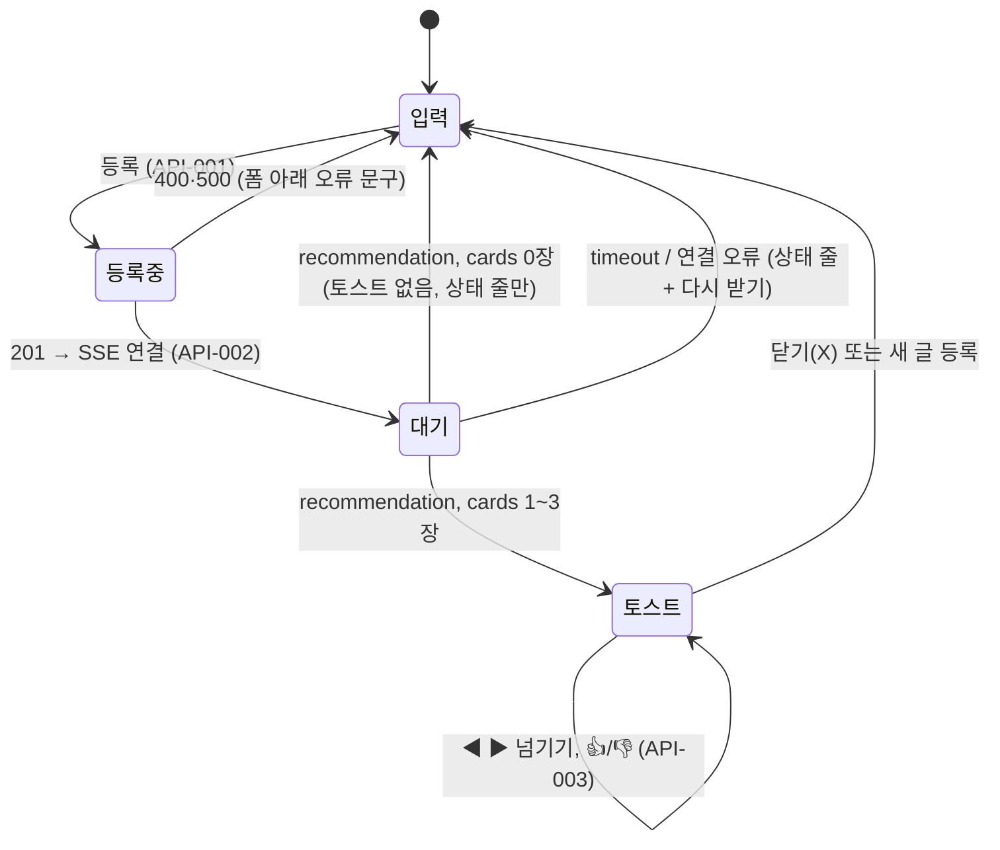

# 11. 화면 설계서

> 문서 상태: 산출물 문서 (개발하며 갱신)
> **규칙**: 새 화면을 구현하기 전에 반드시 여기에 설계를 먼저 작성하고 사용자 확인을 받은 후 구현한다.
> 프론트엔드가 없는 프로젝트라면 이 문서 전체를 ➖ 해당없음 처리한다.

## 1. 화면 목록

> 상태: 📝 설계 / 🔄 개발중 / ✅ 완료 / 🗑 폐기

| ID | 화면명 | 경로(URL) | 접근 권한 | 상태 |
|---|---|---|---|---|
| SCR-001 | 데모 페이지 — 글 입력 + 우측 하단 추천 토스트(카드 1~3장) + 카드별 👍/👎 | `/` | 전체 공개 | ✅ |

> 사전 기입(2026-11-24): 인턴십 프로젝트의 팝업 목업(데스크톱 팝업, 상태별 화면)을 재사용한다. 상태별 화면(로딩, 추천 없음 = 토스트 미표시, 에러)은 구현 직전에 상세 설계한다.

## 2. 화면 흐름도

> 페이지는 1장(`/`)이다. 화면 이동 대신 페이지 안의 상태 변화를 그린다.



## 3. 화면 상세 설계

---

### SCR-001. 데모 페이지

- **경로**: `/` (FastAPI가 `frontend/`를 정적 파일로 서빙. API와 같은 출처라 CORS 불필요, 03_FRONTEND.md 1장)
- **목적**: 커뮤니티 글쓰기를 흉내 내 글을 등록하고, 등록 직후 우측 하단에 뜨는 추천 토스트와 카드별 피드백을 확인한다. 실서비스의 "커뮤니티 사이트가 우리 API를 불러 토스트를 그린다"는 연동 계약(JSON)을 그대로 보여주는 것이 목적
- **진입 경로**: 브라우저로 `http://127.0.0.1:8000/` 직접 접속
- **접근 권한**: 전체 공개 (인증 없음, 서버는 127.0.0.1에만 노출)
- **상태**: ✅ 완료 (설계 확인·구현 2026-11-26, #15)

#### 와이어프레임 — 데스크톱 (폭 641px 이상)

```
┌───────────────────────────────────────────────────────────────┐
│ BootQ 데모 · 커뮤니티 고민 글 → 직무 부트캠프 추천              │
├───────────────────────────────────────────────────────────────┤
│  예시 글: [마케팅 신입] [반도체 공정] [2차전지 품질] [면접만]    │ ← 지어낸 문장을 폼에 채움
│ ┌───────────────────────────────────────────────┐             │
│ │ 고민 그룹 [취업 고민 ▾]   카테고리 [직무 ▾]    │             │
│ │ 희망 직무 [모든 직무     ] 목표 회사 [모든 회사 ] │             │
│ │ 제목     [______________________________]     │             │
│ │ 본문     [                              ]     │             │
│ │          [______________________________]     │             │
│ │                                   [ 등록 ]    │             │
│ │ 상태 줄: 추천을 찾고 있어요…                    │             │
│ └───────────────────────────────────────────────┘             │
│                                  ┌────────────────────────┐   │
│                                  │이런 캠프는 어떠세요? ◀1/3▶ ✕│   │ ← 우측 하단 고정, 폭 380px
│                                  │┌ 안내(review일 때만) ┐ │   │
│                                  │캠프명 (굵게)            │   │
│                                  │사유 문장                │   │
│                                  │#직무 #산업  모집기간 정보 없음│   │
│                                  │후기 준비 중             │   │
│                                  │[상세보기] [신청하기] (비활성)│   │
│                                  │────────────────────────│   │
│                                  │이 추천이 도움이 됐나요? 👍 👎│   │
│                                  └────────────────────────┘   │
└───────────────────────────────────────────────────────────────┘
```

👎를 누르면 같은 카드의 피드백 줄이 사유 선택으로 바뀐다:

```
│ 어떤 점이 아쉬웠나요?                      │
│ [직무가 달라요] [분야가 달라요]             │
│ [지금 필요한 도움이 아니에요] [기타]        │
```

#### 와이어프레임 — 좁은 화면 (폭 640px 이하)

```
┌──────────────────────┐
│ 헤더                  │
│ 예시 글 (가로 스크롤)   │
│ 폼 (칸이 한 줄에 하나)   │
│ …                     │
│┌────────────────────┐│ ← 화면 하단에 붙는 시트 (좌우 여백 0, 위쪽 모서리만 둥글게)
││이런 캠프는…  ◀ 1/3 ▶ ✕││   아이콘 버튼 44px (터치 대상)
││캠프명                ││   배경 어둡게 덮지 않음 (글을 계속 볼 수 있게)
││사유                  ││
││#직무 #산업 모집기간…  ││
││후기 준비 중           ││
││[상세보기][신청하기]    ││
││도움이 됐나요?   👍 👎 ││
│└────────────────────┘│
└──────────────────────┘
```

인턴십 프로젝트의 모바일 목업(하단 시트)을 따르되, 배경 어둡게 덮기(dim)는 뺀다.

#### 구성 요소

| 요소 | 종류 | 동작 / 규칙 |
|---|---|---|
| 예시 글 버튼 | 버튼 4~5개 | 누르면 폼 6칸을 지어낸 예시로 채운다 (유저 원문 금지). 등록은 하지 않음 |
| 고민 그룹 | select | `취업 고민` / `이직 고민` / `대학생 고민` / `랜선 사수` (게이트 1차 확인용) |
| 카테고리 | select | `data/vocab/category_camp_type.csv`의 20종 + 빈 값 |
| 희망 직무 / 목표 회사 | text | 기본값 `모든 직무` / `모든 회사`. 자유 입력 (최대 100자) |
| 제목 / 본문 | text / textarea | 최대 200자 / 5,000자 (`maxlength`). 둘 다 비어도 등록 가능 (게이트가 처리) |
| 등록 | 버튼 | API-001 호출. 응답 대기·SSE 대기 중에는 비활성. 새로 등록하면 열려 있던 토스트를 닫고 이전 SSE를 끊는다 |
| 상태 줄 | 텍스트 | 데모 보조. 진행·결과를 한 줄로 (아래 상태별 화면). 토스트와 별개 |
| 토스트 | aside (우측 하단 고정) | cards가 1장 이상일 때만, 아래에서 올라온다. 한 번에 카드 1장 |
| ◀ ▶ / 페이지 표시 | 아이콘 버튼 | 카드 2장 이상일 때만 보인다. 순환 |
| 닫기 ✕ | 아이콘 버튼 | 아래로 내려가며 사라진다. 같은 글에서는 다시 뜨지 않음 |
| 안내 문구 | 박스 | `review=true` 카드에만: "조건에 딱 맞는 캠프를 찾기는 어려워, 관련 분야의 캠프를 보여드려요." (목업 상태 ②) |
| 캠프명 / 사유 | 텍스트 | `camp_name`, `reason` 그대로 (textContent, HTML로 넣지 않음) |
| 👍 / 👎 | 아이콘 버튼 | **카드마다 따로**. 👍는 바로 API-003(`vote=up`). 👎는 사유 선택 4개를 띄우고, 사유를 고르면 API-003(`vote=down`, `reason`) |
| 👎 사유 | 버튼 4개 | `job_mismatch` 직무가 달라요 / `industry_mismatch` 분야가 달라요 / `not_needed` 지금 필요한 도움이 아니에요 / `other` 기타 |
| 피드백 완료 | 텍스트 | 전송 성공 시 그 카드의 피드백 줄이 "피드백 감사합니다."로 바뀐다. 다른 카드는 영향 없음 |

| 해시태그 | 텍스트 | `cards[].tags` 앞에 `#`. 0개면 비움 (API-002) |
| 모집기간 | 텍스트 (오른쪽 정렬) | 목업 형식 `MM.DD ~ MM.DD · D-n`. 기간 데이터가 없으면 "모집기간 정보 없음"(흐린 글씨). 지금 데이터는 모두 없음 |
| 후기 자리 | 텍스트 | 항상 "후기 준비 중" (목업 상태 ②, 후기 미수집) |
| 상세보기 / 신청하기 | 버튼 (비활성) | 목업 자리만 유지. `disabled` + `title="데모에서는 캠프 페이지가 없어요"`. 캠프 URL이 API 카드에 생기면 활성화 |

목업 카드 모양을 그대로 유지한다 (2026-11-26 사용자 결정). 해시태그는 정규화 결과(대표 직무·산업·스킬)로 채우고, 모집기간은 API에 칸을 두되 데이터가 생기기 전까지 자리 문구를 보인다. 평점·상세보기·신청하기는 데이터가 없어 자리만 유지한다.

#### 연결 API

| 시점 | API ID | 용도 |
|---|---|---|
| 등록 클릭 | API-001 | 글 등록 → `post_id`, `recommendation_id` |
| 등록 201 직후 | API-002 | `EventSource`로 SSE 연결. `recommendation` 또는 `timeout` 이벤트를 받으면 **바로 `close()`** (서버가 닫으면 EventSource가 자동 재접속하므로) |
| 👍 / 👎 사유 클릭 | API-003 | `rank`, `camp_id`, `vote`, `reason` 전송 |

#### 상태별 화면
- **등록 중 / 추천 대기**: 상태 줄 "추천을 찾고 있어요…", 등록 버튼 비활성. 토스트는 띄우지 않는다 (실서비스에서는 글 등록 후 아무것도 안 보이다가 결과가 있을 때만 뜬다)
- **추천 있음**: 토스트 표시, 상태 줄 "추천 N개를 받았어요 (X초)"
- **데이터 없음 (cards 0장)**: **토스트를 띄우지 않는다** (게이트 종료·매칭 0개·LLM 오류 모두 같음, API-002). 상태 줄만 "추천할 캠프가 없어 토스트를 띄우지 않았어요" — 이유(end_reason·error_code)는 화면에 나오지 않으므로 DB·로그에서 본다
- **timeout**: 상태 줄 "응답이 늦어요" + [다시 받기] 버튼 (같은 post_id로 SSE 재접속. 서버 처리는 계속되므로 결과를 받을 수 있다)
- **에러**: API-001 400/500 → 상태 줄에 `error.message`. SSE 연결 오류(404 등, EventSource는 상태 코드를 알려주지 않음) → "추천 결과를 받지 못했어요" + [다시 받기]. 피드백 실패 → 그 카드 피드백 줄에 "전송하지 못했어요. 다시 눌러 주세요" (버튼 유지)

#### 비고
- 파일 구성은 03_FRONTEND.md 1장 폴더 구조 그대로 (`index.html`, `popup.css`, `src/{main,api,toast,types}.ts`, `dist/`는 tsc 출력·git 제외)
- 스타일은 인턴십 프로젝트 팝업 목업 CSS를 재사용하고 데모 폼 스타일만 추가한다. 외부 폰트는 불러오지 않는다 (시스템 글꼴, 오프라인 데모)
- 지원 브라우저: 최신 Chrome·Safari (03_FRONTEND.md 5장). 키보드: 모든 버튼은 `<button>`, 아이콘 버튼은 `aria-label`
- 토스트 영역은 `aria-live="polite"`로 스크린리더에 새 추천을 알린다
- 폭 1024px 이상에서는 폼을 토스트 왼쪽 영역에 둔다 (토스트가 등록 버튼을 가리지 않게. 데모 전용 배치)
- 구현: `frontend/` (서빙 `app/main.py`의 `StaticFiles` 마운트, 테스트 `tests/test_frontend_mount.py`)
